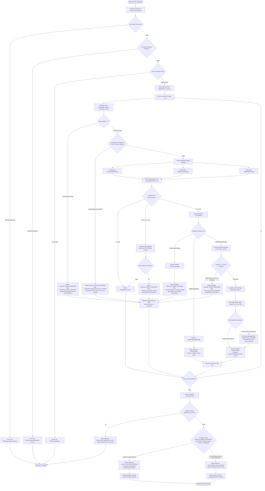

# Spesifikasi Teknis Phase 1.2.1: Layout Classifier Specification (v1.3.4)

**Project:** Bookabook PDF to JPG Automation  
**Phase:** 1.2.1 — Layout Classifier Specification  
**Version:** 1.3.4 (Crop Strategy Separation, Status Bifurcation & Cover Audit Harmonization)  
**Status:** Design & Architectural Specification Only (Read-Only / No Code)  
**Date:** 2026-11-09  
**Author:** Senior Python Engineer & PDF Processing Specialist  

---

## 1. Dokumen Metadata & Riwayat Revisi

| Versi | Tanggal | Penulis | Deskripsi Perubahan |
|---|---|---|---|
| **v1.0** | 2026-11-09 | Engineering Team | Rilis draf awal spesifikasi sistem klasifikasi layout PDF berdasarkan hasil audit Phase 1.1. |
| **v1.1** | 2026-11-09 | Engineering Team | Revisi stakeholder: Aturan *no auto-rotation*, pemisahan *outer margin trimming* vs. *bleed*, penamaan referensi baku, ekspor halaman kosong dengan warning, dan koreksi scoring `SinglePageStrategy`. |
| **v1.2** | 2026-11-09 | Engineering Team | Final technical refinement: Flipped orientation detection, multi-stage blank page detection, taksonomi error, aturan deviasi tick 1.0 mm, dan keputusan konfigurasi JSON MVP. |
| **v1.3** | 2026-11-09 | Engineering Team | Final Consistency Audit: Rekonsiliasi threshold blank page, cropping safety, validasi multi-faktor flipped 4-Up, dimensi output, dan pemisahan taksonomi error. |
| **v1.3.1** | 2026-11-09 | Engineering Team | Final Patch Audit: Koreksi pengurangan koordinat cover ($452.59\text{ pt}$), pembuatan tabel keputusan blank page, penegakan kebijakan ekspor non-blocking, harmonisasi konversi metrik trimming, dan klarifikasi izin PDF. |
| **v1.3.2** | 2026-11-09 | Engineering Team | Secondary Technical Audit: Pemisahan *Observed*, *Calculated*, dan *Unresolved Discrepancy* pada Back Cover; perancangan ulang tabel keputusan blank page berbasis prioritas (P1–P9); penutupan celah batas skor kepercayaan $[0.89, 0.90)$; dan restrukturisasi kriteria penerimaan. |
| **v1.3.3** | 2026-11-09 | Engineering Team | Technical Harmonization: Rekonsiliasi parameter outer margin Opsi B ($13.85 / 14.50\text{ pt}$); audit dimensi Front Cover ($454.51\text{ pt}$); perumusan formula bounding box kuadran Opsi B; dan penyelarasan rentang Single Page di Bagian 4, 5, dan 11. |
| **v1.3.4** | 2026-11-09 | Engineering Team | **Crop Strategy Separation, Status Bifurcation & Cover Audit Harmonization:**<br>1. **Rekonsiliasi Dimensi Cover (Front vs. Back):** Memisahkan target `BACKCOVER.jpg` ($1890 \times 2657\text{ px}$ @ 300 DPI) dan `COVER.jpg` ($630 \times 886\text{ px}$ @ 100 DPI); mendokumentasikan selisih tinggi $1\text{ px}$ antara penskalaan integer $3\times$ ($2658\text{ px}$) vs. render vektor 300 DPI ($2657\text{ px}$) sebagai `UNRESOLVED_ROUNDING_1PX`.<br>2. **Pemisahan Tiga Strategi Crop:** Menetapkan `CoverCropStrategy` (crop marks + spine exclusion + safety hold), `Imposition4UpCropStrategy` (midpoint tick anchor + Opsi B $1773 \times 2538\text{ px}$), dan `SinglePageCropStrategy` (ekspor langsung tanpa pemotongan grid).<br>3. **Pemisahan Status Klasifikasi vs. Kesiapan Cropping:** Memisahkan status pengenalan lembar (`CLASSIFIED`, `UNKNOWN_LAYOUT`) dari kesiapan eksekusi (`CROP_READY`, `MANUAL_REVIEW_REQUIRED`). Lembar Cover ditahan di `MANUAL_REVIEW_REQUIRED` (dilarang auto-crop), sedangkan 4-Up yang aman langsung berstatus `CROP_READY`. Halaman kosong tetap non-blocking.<br>4. **Pembenahan Matriks Verifikasi:** Menerapkan secara ketat status `RESOLVED`, `PARTIALLY RESOLVED`, dan `UNRESOLVED` pada Bagian 16 tanpa menganggap selesai temuan yang masih membutuhkan bukti sumber. |

---

## 2. Arsitektur Sistem Klasifikasi Layout & Kesiapan Cropping

Sistem klasifikasi ini berfungsi sebagai *frontline inspection and routing engine* sebelum proses kalkulasi koordinat, rendering, dan cropping dieksekusi oleh background worker (Celery + Redis). Modul ini bekerja secara *in-memory* menggunakan PyMuPDF tanpa merender seluruh lembar PDF ke bitmap penuh.

Sistem membedakan secara tegas dua tingkatan status pemrosesan:
1. **Status Klasifikasi Layout (`Classification Status`):** Mengidentifikasi apakah karakteristik geometri lembar cocok dengan model template yang terdaftar (`CLASSIFIED` atau `UNKNOWN_LAYOUT`).
2. **Status Kesiapan Cropping (`Crop Readiness Status`):** Memvalidasi apakah formula kalkulasi koordinat dan guardrail keselamatan aman untuk dieksekusi secara otomatis (`CROP_READY`) atau harus menunggu peninjauan admin (`MANUAL_REVIEW_REQUIRED`).

```
+---------------------------------------------------------------------------------------------------+
|                           ARSITEKTUR LAYOUT CLASSIFIER & CROP ROUTING                             |
+---------------------------------------------------------------------------------------------------+
|                                                                                                   |
|  [ Input PDF File ]                                                                               |
|          │                                                                                        |
|          ▼                                                                                        |
|  ┌─────────────────────────────────────────────────────────────────────────────────────────────┐  |
|  │ PDF Stream & Ingestion Inspector (FastAPI Gateway)                                         │  |
|  │ ├─ Broken / Malformed Stream?  ──> Throw PDFCorruptedError (HTTP 422)                       │  |
|  │ ├─ User Password Required?    ──> Throw PDFPasswordRequiredError (HTTP 401)                 │  |
|  │ └─ Permission Restrict Policy ──> Throw PDFPermissionDeniedError (HTTP 403 Policy Block)    │  |
|  └─────────────────────────────────────────────────────────────────────────────────────────────┘  |
|          │ (PDF Sehat, Terbaca & Terbuka)                                                         |
|          ▼                                                                                        |
|  ┌─────────────────────────────────────────────────────────────────────────────────────────────┐  |
|  │ TAHAP 1: In-Memory Layout Classifier Engine (PyMuPDF - Strategy Pattern + Plugin Registry)  │  |
|  │ ┌─────────────────────────┐ ┌─────────────────────────┐ ┌─────────────────────────────────┐ │  |
|  │ │ CoverSpreadStrategy     │ │ Imposition4UpStrategy   │ │ SinglePageStrategy              │ │  |
|  │ │ (Layout A: Cover Wrap)  │ │ (Layout B: 4-Up Grid)   │ │ (Layout C: 1-Up Single)         │ │  |
|  │ └─────────────────────────┘ └─────────────────────────┘ └─────────────────────────────────┘ │  |
|  │               ▲                          ▲                                ▲                 │  |
|  │               └──────────────────────────┴────────────────────────────────┘                 │  |
|  │                                          │                                                  │  |
|  │                                [ Evaluasi Skor Fitur C ]                                    │  |
|  │                                          │                                                  │  |
|  │                 ┌────────────────────────┴────────────────────────┐                         │  |
|  │                 ▼                                                 ▼                         │  |
|  │        Skor C >= 0.90                                   Skor 0.65 <= C < 0.90               │  |
|  │      [ CLASSIFIED ]                                  (Visual Fallback Ambiguity)            │  |
|  │                 │                                                 │                         │  |
|  │                 │                                                 ▼                         │  |
|  │                 │                                 ┌───────────────────────────────┐         │  |
|  │                 │                                 │ Visual Boundary Fallback      │         │  |
|  │                 │                                 │ (OpenCV In-Memory Check)      │         │  |
|  │                 │                                 └───────────────┬───────────────┘         │  |
|  │                 │                                                 │                         │  |
|  │                 │                             ┌───────────────────┴───────────────────┐     │  |
|  │                 │                             ▼ Lolos verifikasi kontur               ▼ Gagal│
|  │                 │                     [ CLASSIFIED (CV) ]                 [ UNKNOWN_LAYOUT ]│
|  └─────────────────┼─────────────────────────────┼───────────────────────────────────────┼─────┘  |
|                    │                             │                                       │        |
|                    ▼                             ▼                                       ▼        |
|  ┌─────────────────────────────────────────────────────────────────────────────────────────────┐  |
|  │ TAHAP 2: Crop Strategy Router & Safety Guardrails Validator                                 │  |
|  │                                                                                             │  |
|  │ ├─ Skor C < 0.65 / CV Gagal?       ──> UNKNOWN_LAYOUT (Reject Pipeline & Halt Execution)   │  |
|  │ ├─ Rotasi != 0 / Flipped 4-Up?     ──> MANUAL_REVIEW_REQUIRED (NO Auto-Rotate, NO Auto-Crop)│  |
|  │ ├─ Tick Deviasi > 1.0 mm/Asimetri? ──> MANUAL_REVIEW_REQUIRED (NO Auto-Crop)                │  |
|  │ ├─ CV Fallback Digunakan?          ──> MANUAL_REVIEW_REQUIRED (NO Auto-Crop)                │  |
|  │ │                                                                                           │  |
|  │ ├─ Strategi: CoverCropStrategy                                                              │  |
|  │ │  └─ Selisih Vektor/Raster Cover? ──> MANUAL_REVIEW_REQUIRED (Dilarang Auto-Crop Produksi)│  |
|  │ │                                                                                           │  |
|  │ ├─ Strategi: Imposition4UpCropStrategy                                                      │  |
|  │ │  ├─ Geometri Aman (Deviasi<=1mm)?──> CROP_READY (Eksekusi Bounding Box Opsi B)            │  |
|  │ │  └─ Blank Page Terdeteksi?       ──> CROP_READY (Non-Blocking: Ekspor + Warning Flag UI)  │  |
|  │ │                                                                                           │  |
|  │ └─ Strategi: SinglePageCropStrategy                                                         │  |
|  │    └─ Dimensi Sesuai Profil?       ──> CROP_READY (Ekspor Langsung Tanpa Grid)              │  |
|  └─────────────────┬─────────────────────────────────────────────┬─────────────────────────────┘  |
|                    │                                             │                                |
|                    ▼                                             ▼                                |
|             [ CROP_READY ]                          [ MANUAL_REVIEW_REQUIRED ]                    |
|   (Formula & safety tervalidasi)                 (Perlu konfirmasi / preview admin)               |
|                    │                                             │                                |
|                    ▼                                             ▼                                |
|  Eksekusi Crop Plan Otomatis via Celery         Staging Inspection & Preview Admin di UI          |
+---------------------------------------------------------------------------------------------------+
```

---

## 3. Parameter Metadata dan Geometri yang Diperiksa

Ekstraksi parameter dilakukan menggunakan PyMuPDF secara *in-memory* tanpa rasterisasi penuh lembar PDF.

### A. Parameter Tingkat Lembar (Per-Page Geometric Features)
1. **Dimensi Fisik & Orientasi:**
   - `width_pt`, `height_pt`: Dimensi dari `page.rect` (default `MediaBox`).
   - `aspect_ratio`: $\text{ratio} = \frac{\text{width}}{\text{height}}$.
   - `orientation`: `LANDSCAPE` jika $\text{width} > \text{height}$, `PORTRAIT` jika $\text{height} > \text{width}$, `SQUARE` jika $|\text{width} - \text{height}| \le 2.0\text{ pt}$.
   - `rotation`: Nilai rotasi lembar PDF (`page.rotation` $\in \{0, 90, 180, 270\}$).
2. **PDF Bounding Boxes:**
   - Konsistensi antara `MediaBox`, `CropBox`, `BleedBox`, `TrimBox`, dan `ArtBox`.
   - Pada Adobe Illustrator PDF tanpa TrimBox eksplisit, nilai `TrimBox == MediaBox`.
3. **Analisis Objek Vektor (`Drawing Objects`):**
   - `total_drawings`: Jumlah total objek vektor (`len(page.get_drawings())`).
   - `single_segment_lines`: Garis lurus independen (`items[0][0] == 'l'`).
   - `stroke_properties`: Tebal garis (`width`) dan warna garis (`color == (0.0, 0.0, 0.0)`).
   - `edge_midpoint_ticks`: Garis pada batas luar lembar di titik tengah ($x \approx W/2$ atau $y \approx H/2$).
   - `tick_coordinates`: Koordinat titik ujung pasangan tick marks untuk pengujian deviasi sumbu.
   - `crease_lines`: Garis lipatan vertikal di area punggung buku (*spine zone*).
4. **Analisis Objek Raster (`Image Objects`):**
   - `image_count`: Jumlah gambar tertanam (`len(page.get_images())`).
   - `image_dimensions`: Resolusi native gambar tertanam ($W \times H\text{ px}$).
   - `clip_paths`: Keberadaan operator clipping path (`re W n`) dalam stream konten.

### B. Parameter Tingkat Dokumen (Document-Level Structural Integrity)
1. `total_pdf_pages`: Jumlah total lembar dalam file PDF.
2. `page_sequence_signature`: Pola urutan layout, misalnya `[COVER_SPREAD, IMPOSITION_4UP, IMPOSITION_4UP, ...]`.
3. `expected_book_pages`: Proyeksi total halaman buku hasil ekstraksi ($N_{\text{cover}} + N_{\text{content}}$).

---

## 4. Identifikasi Karakteristik Tiga Layout Utama

```
+---------------------------------------------------------------------------------------------------------+
|                                    KARAKTERISTIK PEMBEDA LAYOUT                                         |
+--------------------------+----------------------------+----------------------------+--------------------+
| Parameter                | 1. Cover Spread (Layout A) | 2. 4-Up Imposition (B)     | 3. Single Page (C) |
+--------------------------+----------------------------+----------------------------+--------------------+
| Orientasi Standard       | Landscape                  | Portrait                   | Portrait           |
| Dimensi Baku Desain      | 1247.24 x 878.74 pt (±2%)  | 878.74 x 1247.24 pt (±2%)  | 425.52 x 609.12 pt |
| Dimensi Fisik Bersih     | 440.0 x 310.0 mm           | 310.0 x 440.0 mm           | 150.11 x 214.88 mm |
| Jendela Toleransi Uji    | 1220-1270 x 860-900 pt     | 860-900 x 1220-1270 pt     | 415-450 x 590-640 pt|
| Aspect Ratio Nominal     | ~1.419 (Landscape)         | ~0.704 (Portrait)          | ~0.699 (Portrait)  |
| Vector Mark: Center Tick | Tidak Ada                  | Ada (4 tick di midpoint)   | Tidak Ada          |
| Vector Mark: Spine Lines | Ada (4-6 garis lipatan)    | Tidak Ada                  | Tidak Ada          |
| Vector Mark: Outer Trim  | Ada (Crop marks 0.5 pt)    | Tidak Ada (hanya tick mid) | Opsional (L-marks) |
| Jumlah Gambar Tertanam   | Banyak (≥ 10, multi-asset) | Tepat 2 gambar (spread)    | 1 gambar / spread  |
| Yield Halaman Buku       | 2 halaman (Front + Back)   | 4 halaman (2x2 grid)       | 1 halaman buku     |
+--------------------------+----------------------------+----------------------------+--------------------+
```

---

## 5. Rule-Based Classification & Confidence Scoring Boundaries

Sistem menggunakan mesin evaluasi berbobot (*weighted scoring engine*) untuk menghitung nilai kepercayaan ($C \in [0.0, 1.0]$).

### Definisi Batas Nilai Kepercayaan (Confidence Boundaries)
Batas klasifikasi ditetapkan secara eksak tanpa celah numerik:
- **$C \in [0.0, 0.65)$ $\rightarrow$ `UNKNOWN_LAYOUT`:** Dokumen tidak cocok dengan strategi manapun. Job ditolak dan alur kerja dihentikan.
- **$C \in [0.65, 0.90)$ $\rightarrow$ Visual Fallback Layer:** Terdapat ambiguitas geometris. Sistem memicu modul verifikasi batas kontur OpenCV in-memory. Jika terverifikasi, berstatus `CLASSIFIED (CV)` namun kesiapan cropping wajib `MANUAL_REVIEW_REQUIRED` (Flag: `OPENCV_FALLBACK_USED`, no auto-crop). Jika gagal, menjadi `UNKNOWN_LAYOUT`.
- **$C \in [0.90, 1.00]$ $\rightarrow$ `CLASSIFIED` (High-Confidence):** Lembar cocok secara meyakinkan dengan profil layout target. Lanjut ke Tahap 2: Crop Strategy Router & Safety Guardrails Validator.

### Rule 1: Cover Spread Detector (`CoverSpreadStrategy`)
1. **Fitur Dimensi Lembar (Bobot: 0.35):** `orientation == LANDSCAPE`, $1220 \le \text{width} \le 1270\text{ pt}$, $860 \le \text{height} \le 900\text{ pt}$.
2. **Fitur Garis Trim Horizontal (Bobot: 0.25):** Pasangan garis trim di $y \approx 120.49 \pm 2\text{ pt}$ dan $y \approx 758.25 \pm 2\text{ pt}$ (jarak $\approx 637.76\text{ pt}$).
3. **Fitur Garis Lipatan Punggung / Spine Creases (Bobot: 0.25):** $\ge 2$ pasang garis vertikal di zona tengah $x \in [575, 685\text{ pt}]$ yang mengapit punggung buku $\approx 15\text{ mm}$ ($42.57\text{ pt}$).
4. **Fitur Batas Potong Luar / Outer Trim Lines (Bobot: 0.15):** Garis potong batas luar di $x \approx 155.95 \pm 2\text{ pt}$ (tepi kiri) dan $x \approx 1105.62 \pm 2\text{ pt}$ (tepi kanan).

$$\text{Score}_{\text{Cover}} = \sum (\text{RuleMet}_i \times \text{Weight}_i)$$

### Rule 2: 4-Up Imposition Detector (`Imposition4UpStrategy`)
1. **Fitur Dimensi Lembar (Bobot: 0.35):** `orientation == PORTRAIT`, $860 \le \text{width} \le 900\text{ pt}$, $1220 \le \text{height} \le 1270\text{ pt}$.
2. **Fitur 4 Midpoint Vector Ticks (Bobot: 0.35):** Tepat 4 tanda centang vektor (tebal $0.8 - 1.2\text{ pt}$, panjang $5 - 10\text{ pt}$) pada perimeter luar di titik tengah:
   - Tick Kiri: $x \in [0, 10]\text{ pt}$, $y \approx H/2 \pm 2.835\text{ pt}$ ($y \approx 623.62\text{ pt}$)
   - Tick Kanan: $x \in [W-10, W]\text{ pt}$, $y \approx H/2 \pm 2.835\text{ pt}$ ($y \approx 623.62\text{ pt}$)
   - Tick Atas: $x \approx W/2 \pm 2.835\text{ pt}$ ($x \approx 439.37\text{ pt}$), $y \in [0, 10]\text{ pt}$
   - Tick Bawah: $x \approx W/2 \pm 2.835\text{ pt}$ ($x \approx 439.37\text{ pt}$), $y \in [H-10, H]\text{ pt}$
3. **Fitur Struktur Gambar Raster Tertanam (Bobot: 0.20):** Tepat 2 gambar tertanam resolusi tinggi ($3507 \times 2480\text{ px}$) yang dipotong secara vertikal oleh PDF clip path (`re W n`).
4. **Ketiadaan Corner Marks (Bobot: 0.10):** Tidak ada crop marks di area empat sudut luar lembar.

$$\text{Score}_{\text{4Up}} = \sum (\text{RuleMet}_i \times \text{Weight}_i)$$

### Rule 3: Single Page Detector (`SinglePageStrategy`) — *Non-Tautologis*
1. **Fitur Dimensi Buku Tunggal (Bobot: 0.40):** `orientation == PORTRAIT`, dengan rentang toleransi scoring $415 \le \text{width} \le 450\text{ pt}$ ($432.5 \pm 17.5\text{ pt}$) dan $590 \le \text{height} \le 640\text{ pt}$ ($615 \pm 25\text{ pt}$), rasio aspek $0.68 \le \text{ratio} \le 0.72$. *(Mencakup dimensi nominal buku komik A5 Bookabook bersih $425.52 \times 609.12\text{ pt}$ beserta variasi bleed desainer).*
2. **Ketiadaan Garis Bagi Interior / No Midpoint Dividers (Bobot: 0.30):** Tidak terdapat tanda potong atau garis pembagi di sekitar sumbu tengah $x \approx W/2$ maupun $y \approx H/2$.
3. **Ketiadaan Fitur Spine / No Crease Lines (Bobot: 0.15):** Tidak ada kelompok garis lipatan vertikal punggung di area manapun.
4. **Karakteristik Batas Tunggal / Single Art Boundary (Bobot: 0.15):** Memiliki tepat satu batas artwork kontinu atau L-shaped corner crop marks mandiri.

$$\text{Score}_{\text{Single}} = \sum (\text{RuleMet}_i \times \text{Weight}_i)$$

---

## 6. Flipped Orientation Detection & Tick Mark Deviation

### A. Flipped Orientation Detection (Validasi Multi-Faktor 4-Up Landscape)
Kombinasi dimensi landscape, ketiadaan spine, dan keberadaan 4 midpoint ticks tidak membuktikan secara mutlak bahwa lembar tersebut adalah 4-Up terbalik (bisa berupa centerfold spread). Sistem menerapkan validasi multi-faktor:
1. $W \approx 1247.24\text{ pt}, H \approx 878.74\text{ pt}$ (Landscape).
2. Tidak ada garis lipatan spine di zona tengah $x \in [575, 685\text{ pt}]$.
3. 4 tick vektor di perimeter luar sumbu landscape ($x \approx 623.62\text{ pt}$ dan $y \approx 439.37\text{ pt}$).
4. Struktur raster: 2 gambar tertanam rasio aspek $\approx 1.414$ yang dirotasi $90^\circ$, ATAU operator clipping path (`re W n`) membelah lembar sejajar sumbu panjang.

**Penanganan Status:**
- Status Klasifikasi: **`CANDIDATE_IMPOSITION_4UP_FLIPPED`**.
- Status Kesiapan Cropping: **`MANUAL_REVIEW_REQUIRED`** (Flag: `FLIPPED_ORIENTATION_DETECTED`).
- **Safety Policy:** Dilarang auto-rotation dan dilarang auto-cropping.

---

### B. Aturan Deviasi Tick Marks (Tick Mark Deviation Rules)
Sumbu potong didefinisikan oleh pasangan tick marks:
$$\Delta x = |x_T - x_B| \quad \text{dan} \quad \Delta y = |y_L - y_R|$$

1. **Batas Toleransi Maksimal:** $\Delta x \le 1.0\text{ mm}$ ($2.835\text{ pt}$) dan $\Delta y \le 1.0\text{ mm}$ ($2.835\text{ pt}$).
2. **Kondisi Dalam Toleransi ($\le 1.0\text{ mm}$):** Sumbu potong dihitung dari koordinat rata-rata:
   $$x_{\text{cut}} = \frac{x_T + x_B}{2}, \quad y_{\text{cut}} = \frac{y_L + y_R}{2}$$
3. **Kondisi Melebihi Toleransi ($> 1.0\text{ mm}$) atau Asimetris:**
   - Status Klasifikasi: `CLASSIFIED (IMPOSITION_4UP)`.
   - Status Kesiapan Cropping: **`MANUAL_REVIEW_REQUIRED`** (Flag: `TICK_DEVIATION_EXCEEDED` / `TICK_ASYMMETRY_DETECTED`). Auto-cropping dihentikan seketika.

---

## 7. Robust Blank Page Detection (Priority-Based MECE Hierarchy)

### A. Rationale & Eliminasi Tumpang Tindih
Evaluasi dilakukan pada thumbnail per-kuadran ($100\text{ DPI}$). Untuk memastikan tidak ada ambiguitas, overlap, maupun kombinasi tanpa keputusan, evaluasi menerapkan **Hierarki Prioritas Aturan (First-Match-Wins)**. Begitu suatu kondisi terpenuhi, evaluasi berhenti dan hasil langsung ditetapkan.

### B. Tabel Keputusan Lengkap Berbasis Prioritas (MECE Priority Table)

| Prioritas | Kasus ID | Aturan & Kondisi Parameter Eksak | Keputusan Status | Tindakan Pipeline & Crop Readiness |
|---|---|---|---|---|
| **P1** | **BP-01** | Objek vektor/teks aktif terdeteksi selain background rect putih tunggal | `CONTENT_PRESENT` | Lolos normal, bukan blank (`CROP_READY`). |
| **P2** | **BP-02** | $\min(I) < 220$ | `CONTENT_PRESENT` | Lolos normal (tinta gelap/teks/panel) (`CROP_READY`). |
| **P3** | **BP-03** | $N_{\text{edge}} > 10\text{ px}$ | `CONTENT_PRESENT` | Lolos normal (kontur tepi signifikan) (`CROP_READY`). |
| **P4** | **BP-04** | $\min(I) \in [220, 249]$ **DAN** $N_{\text{edge}} \in [5, 10]\text{ px}$ **DAN** $\text{DR} > 15$ **DAN** $\sigma \ge 1.0$ | `CONTENT_PRESENT` | Lolos normal (ilustrasi pastel/pucat) (`CROP_READY`). |
| **P5** | **BP-05** | $\min(I) \in [220, 249]$ **DAN** $N_{\text{edge}} \in [5, 10]\text{ px}$ **DAN** ($\text{DR} \le 15$ **ATAU** $\sigma < 1.0$) | `LOW_CONTRAST_BLANK_SUSPECTED` | **Ekspor normal** (`CROP_READY`), flag warning badge. |
| **P6** | **BP-06A** | $\min(I) \in [220, 249]$ **DAN** $N_{\text{edge}} < 5\text{ px}$ **DAN** $\text{DR} > 15$ | `LOW_CONTRAST_BLANK_SUSPECTED` | **Ekspor normal** (`CROP_READY`), flag warning badge. |
| **P6** | **BP-06B** | $\min(I) \in [220, 249]$ **DAN** $N_{\text{edge}} < 5\text{ px}$ **DAN** $\text{DR} \in [5, 15]$ | `LOW_CONTRAST_BLANK_SUSPECTED` | **Ekspor normal** (`CROP_READY`), flag warning badge. |
| **P6** | **BP-06C** | $\min(I) \in [220, 249]$ **DAN** $N_{\text{edge}} < 5\text{ px}$ **DAN** $\text{DR} < 5$ **DAN** $\sigma \ge 1.0$ | `LOW_CONTRAST_BLANK_SUSPECTED` | **Ekspor normal** (`CROP_READY`), flag warning badge. |
| **P6** | **BP-06D** | $\min(I) \in [220, 249]$ **DAN** $N_{\text{edge}} < 5\text{ px}$ **DAN** $\text{DR} < 5$ **DAN** $\sigma < 1.0$ | `LOW_CONTRAST_BLANK_SUSPECTED` | **Ekspor normal** (`CROP_READY`), flag warning badge. |
| **P7** | **BP-07** | $\min(I) \ge 250$ **DAN** $N_{\text{edge}} \in [5, 10]\text{ px}$ | `LOW_CONTRAST_BLANK_SUSPECTED` | **Ekspor normal** (`CROP_READY`), flag warning badge. |
| **P8** | **BP-08A** | $\min(I) \ge 250$ **DAN** $N_{\text{edge}} < 5\text{ px}$ **DAN** $\text{DR} > 5$ | `LOW_CONTRAST_BLANK_SUSPECTED` | **Ekspor normal** (`CROP_READY`), flag warning badge. |
| **P8** | **BP-08B** | $\min(I) \ge 250$ **DAN** $N_{\text{edge}} < 5\text{ px}$ **DAN** $\text{DR} \le 5$ **DAN** $\sigma \ge 0.5$ | `LOW_CONTRAST_BLANK_SUSPECTED` | **Ekspor normal** (`CROP_READY`), flag warning badge. |
| **P8** | **BP-08C** | $\min(I) \ge 250$ **DAN** $N_{\text{edge}} < 5\text{ px}$ **DAN** $\text{DR} \le 5$ **DAN** $\sigma < 0.5$ **DAN** $\mu < 253.0$ | `LOW_CONTRAST_BLANK_SUSPECTED` | **Ekspor normal** (`CROP_READY`), flag warning badge. |
| **P9** | **BP-09** | $\min(I) \ge 250$ **DAN** $N_{\text{edge}} < 5\text{ px}$ **DAN** $\text{DR} \le 5$ **DAN** $\sigma < 0.5$ **DAN** $\mu \ge 253.0$ | `BLANK_PAGE_DETECTED` | **Ekspor normal** (`CROP_READY`), flag warning badge. |

### C. Kebijakan Ekspor Mutlak & Non-Blocking Warning
- Seluruh halaman yang berstatus `BLANK_PAGE_DETECTED` maupun `LOW_CONTRAST_BLANK_SUSPECTED` **tetap diekspor normal** menjadi berkas `PAGE-XX.jpg`.
- Urutan dan penomoran halaman tidak bergeser.
- Deteksi halaman kosong **tidak menghentikan antrean cropping otomatis** (berstatus non-blocking warning, kesiapan cropping tetap `CROP_READY` dengan flag metadata `BLANK_PAGE_WARNING`).

---

## 8. Output Dimension & Crop Strategy Specifications

Sistem membedakan tiga strategi pemotongan independen berdasarkan arsitektur lembar layout:

```
+---------------------------------------------------------------------------------------------------+
|                               TIGA STRATEGI CROP INDEPENDEN SISTEM                                 |
+--------------------------+---------------------------------+--------------------------------------+
| Strategi Pemotongan      | Input Lembar Target             | Mekanisme & Kebijakan Eksekusi       |
+--------------------------+---------------------------------+--------------------------------------+
| 1. CoverCropStrategy     | Page 1 (Landscape Cover Spread) | Crop marks 0.5 pt + Spine exclusion. |
|                          | Target: BACKCOVER & COVER.jpg   | HOLD AUTO-CROP (MANUAL_REVIEW_REQ).  |
+--------------------------+---------------------------------+--------------------------------------+
| 2. Imposition4UpCrop     | Pages 2–6 (Portrait 4-Up Grid)  | Anchor midpoint ticks + Bounding box |
|    Strategy              | Target: PAGE-01 s/d PAGE-20     | Opsi B: 1773 x 2538 px (CROP_READY). |
+--------------------------+---------------------------------+--------------------------------------+
| 3. SinglePageCrop        | Lembar Halaman Tunggal (A5)     | Ekspor langsung tanpa grid.          |
|    Strategy              | Target: 1 Halaman Buku          | CROP_READY jika rotasi == 0.         |
+--------------------------+---------------------------------+--------------------------------------+
```

---

### A. Audit Dimensi Cover Spread: Front Cover vs. Back Cover

#### 1. Data Hasil Observasi (Observed Values)
- **Koordinat Vektor PDF Page 1 (PyMuPDF):**
  - Tepi potong kiri luar (Back Cover Outer): $x_{\text{left}} = 155.95461\text{ pt}$ ($55.017\text{ mm}$).
  - Garis lipatan punggung dalam kiri (Spine Inner Left Crease):
    - Titik atas: $x = 608.49170\text{ pt}$ ($214.664\text{ mm}$).
    - Titik bawah: $x = 608.54248\text{ pt}$ ($214.682\text{ mm}$).
    - Nilai rata-rata: $x = 608.51709\text{ pt}$ ($214.673\text{ mm}$).
  - Garis lipatan punggung dalam kanan (Spine Inner Right Crease): $x = 651.10938\text{ pt}$ ($229.702\text{ mm}$).
  - Tepi potong kanan luar (Front Cover Outer): $x_{\text{right}} = 1105.61914\text{ pt}$ ($389.988\text{ mm}$).
  - Tepi potong atas: $y_{\text{top}} = 120.48999\text{ pt}$ ($42.506\text{ mm}$).
  - Tepi potong bawah: $y_{\text{bottom}} = 758.25067\text{ pt}$ ($267.499\text{ mm}$).
- **Dimensi Berkas Referensi Desainer (Raster Ground Truth):**
  - `BACKCOVER.jpg`: $1890 \times 2657\text{ px}$ pada 300 DPI (RGB).
  - `COVER.jpg`: $630 \times 886\text{ px}$ pada 100 DPI (RGB).

#### 2. Nilai Hasil Perhitungan (Calculated Values)
- **Tinggi Vertikal Vektor:**
  $$H_{\text{vec}} = 758.25067 - 120.48999 = 637.76068\text{ pt} = 225.000\text{ mm}$$
  - Pada 300 DPI: $\text{round}\left(637.76068 \times \frac{300}{72}\right) = \mathbf{2657\text{ px}}$ *(Identik 100% dengan `BACKCOVER.jpg`)*.
  - Pada 100 DPI: $\text{round}\left(637.76068 \times \frac{100}{72}\right) = \text{round}(885.7787) = \mathbf{886\text{ px}}$ *(Identik 100% dengan `COVER.jpg`)*.
- **Lebar Vektor Back Cover:**
  $$W_{\text{back\_vec}} = 608.54248 - 155.95461 = \mathbf{452.58787\text{ pt}} \approx 452.59\text{ pt} \quad (159.661\text{ mm})$$
  $$\text{Pixel 300 DPI} = \text{round}\left(452.58787 \times \frac{300}{72}\right) = \mathbf{1885.78\text{ px}} \approx 1886\text{ px}$$
- **Lebar Vektor Front Cover:**
  $$W_{\text{front\_vec}} = 1105.61914 - 651.10938 = \mathbf{454.50976\text{ pt}} \approx 454.51\text{ pt} \quad (160.341\text{ mm})$$
  $$\text{Pixel 300 DPI} = \text{round}\left(454.50976 \times \frac{300}{72}\right) = \mathbf{1893.79\text{ px}} \approx 1894\text{ px}$$
- **Lebar Target Berkas Referensi Desainer:**
  $$W_{\text{target}} = 1890\text{ px} \times \frac{72}{300} = \mathbf{453.600\text{ pt}} = \mathbf{160.020\text{ mm}}$$

#### 3. Analisis Ketidaksesuaian Dimensi Cover (`UNRESOLVED`)
1. **Ketidaksesuaian Tinggi Cover (`COVER.jpg` vs. `BACKCOVER.jpg`):**
   - Berkas `BACKCOVER.jpg` pada 300 DPI berukuran tinggi **$2657\text{ px}$**.
   - Berkas `COVER.jpg` pada 100 DPI berukuran tinggi **$886\text{ px}$**. Jika diskalakan secara integer $3\times$ ($300 / 100$), hasilnya adalah **$2658\text{ px}$** ($886 \times 3 = 2658\text{ px}$).
   - Selisih $1\text{ px}$ ini muncul akibat pembulatan integer pada ekspor 100 DPI ($885.78\text{ pt} \rightarrow 886\text{ px}$).
   - **Status:** **UNRESOLVED_ROUNDING_1PX**. Apakah target produksi `COVER.jpg` pada 300 DPI adalah $2657\text{ px}$ (sesuai render vektor langsung) atau $2658\text{ px}$ (sesuai penskalaan $3\times$ referensi) harus dikonfirmasi ke tim desain.
2. **Ketidaksesuaian Lebar Back Cover:**
   $$\Delta W_{\text{back}} = 452.588 - 453.600 = \mathbf{-1.012\text{ pt}} \quad (\mathbf{-4.22\text{ px}} \text{ @ 300 DPI}, \mathbf{-0.357\text{ mm}}) \rightarrow \text{\textbf{UNRESOLVED}}$$
3. **Ketidaksesuaian Lebar Front Cover:**
   $$\Delta W_{\text{front}} = 454.510 - 453.600 = \mathbf{+0.910\text{ pt}} \quad (\mathbf{+3.79\text{ px}} \text{ @ 300 DPI}, \mathbf{+0.321\text{ mm}}) \rightarrow \text{\textbf{UNRESOLVED}}$$
4. **Asimetri Vektor Cover PDF:**
   $$W_{\text{front\_vec}} - W_{\text{back\_vec}} = 454.510 - 452.588 = \mathbf{1.922\text{ pt}} \quad (\mathbf{8.01\text{ px}} \text{ @ 300 DPI}, \mathbf{0.678\text{ mm}}) \rightarrow \text{\textbf{UNRESOLVED}}$$

---

### B. Spesifikasi Detail Tiga Strategi Pemotongan (Crop Strategies)

#### 1. `CoverCropStrategy` (Khusus Layout A: Cover Spread)
- **Mekanisme Geometri:**
  - Mengidentifikasi crop marks luar ($x = 155.95, 1105.62, y = 120.49, 758.25\text{ pt}$).
  - Memisahkan zona punggung (*spine*) selebar $15.02\text{ mm}$ ($42.57\text{ pt}$) pada $x \in [608.52, 651.11]\text{ pt}$.
- **Target Dimensi Referensi:**
  - `BACKCOVER`: $1890 \times 2657\text{ px}$ @ 300 DPI ($453.60 \times 637.76\text{ pt}$).
  - `COVER`: Target nominal $1890 \times 2657\text{ px}$ @ 300 DPI (pending konfirmasi $2658\text{ px}$).
- **Kebijakan Keselamatan Mutlak (Safety Enforcement):**
  - **Dilarang Menjalankan Auto-Crop Produksi.**
  - Karena terdapat selisih dimensi lebar (-1.01 pt dan +0.91 pt) serta variasi tinggi 1 px yang berstatus `UNRESOLVED`, status kesiapan cropping untuk lembar Cover Spread **wajib berstatus `MANUAL_REVIEW_REQUIRED`**.
  - Pipeline hanya memetakan koordinat *preview overlay* ke Dashboard Admin, dan menunggu persetujuan/keputusan manual admin sebelum file final disimpan.

---

#### 2. `Imposition4UpCropStrategy` (Khusus Layout B: 4-Up Imposition Grid)
- **Mekanisme Geometri (Formula Anchor Opsi B):**
  - Sumbu potong dihitung dari perpotongan rata-rata tick mark interior:
    $$x_{\text{cut}} = \frac{x_T + x_B}{2} \approx 439.37\text{ pt}, \quad y_{\text{cut}} = \frac{y_L + y_R}{2} \approx 623.62\text{ pt}$$
  - Sumbu dalam $(x_{\text{cut}}, y_{\text{cut}})$ adalah pertemuan antarhalaman (*flush cut*, margin trim = $0.0\text{ pt}$).
  - Dimensi target bersih halaman komik A5: $W_{\text{net}} = 425.52\text{ pt}$, $H_{\text{net}} = 609.12\text{ pt}$.
- **Formula Bounding Box Kuadran (satuan Point):**
  - **Kuadran 1 (Kiri Atas / `PAGE-01.jpg`):** Arah $-X, -Y$ dari anchor.
    $$[x_{\min}, y_{\min}, x_{\max}, y_{\max}] = [x_{\text{cut}} - 425.52, \; y_{\text{cut}} - 609.12, \; x_{\text{cut}}, \; y_{\text{cut}}]$$
    *(Margin luar terbuang: Kiri $= 13.85\text{ pt} / 4.886\text{ mm}$, Atas $= 14.50\text{ pt} / 5.115\text{ mm}$).*
  - **Kuadran 2 (Kanan Atas / `PAGE-02.jpg`):** Arah $+X, -Y$ dari anchor.
    $$[x_{\min}, y_{\min}, x_{\max}, y_{\max}] = [x_{\text{cut}}, \; y_{\text{cut}} - 609.12, \; x_{\text{cut}} + 425.52, \; y_{\text{cut}}]$$
    *(Margin luar terbuang: Kanan $= 13.85\text{ pt}$, Atas $= 14.50\text{ pt}$).*
  - **Kuadran 3 (Kiri Bawah / `PAGE-03.jpg`):** Arah $-X, +Y$ dari anchor.
    $$[x_{\min}, y_{\min}, x_{\max}, y_{\max}] = [x_{\text{cut}} - 425.52, \; y_{\text{cut}}, \; x_{\text{cut}}, \; y_{\text{cut}} + 609.12]$$
    *(Margin luar terbuang: Kiri $= 13.85\text{ pt}$, Bawah $= 14.50\text{ pt}$).*
  - **Kuadran 4 (Kanan Bawah / `PAGE-04.jpg`):** Arah $+X, +Y$ dari anchor.
    $$[x_{\min}, y_{\min}, x_{\max}, y_{\max}] = [x_{\text{cut}}, \; y_{\text{cut}}, \; x_{\text{cut}} + 425.52, \; y_{\text{cut}} + 609.12]$$
    *(Margin luar terbuang: Kanan $= 13.85\text{ pt}$, Bawah $= 14.50\text{ pt}$).*
- **Konversi 300 DPI & Aturan Validasi Pipeline:**
  $$W_{\text{px}} = \text{round}\left(425.52 \times \frac{300}{72}\right) = \text{round}(1773.0000) = \mathbf{1773\text{ px}}$$
  $$H_{\text{px}} = \text{round}\left(609.12 \times \frac{300}{72}\right) = \text{round}(2538.0000) = \mathbf{2538\text{ px}}$$
  - Pipeline memvalidasi ketat: `assert W == 1773 and H == 2538`.
- **Kebijakan Kesiapan Cropping:**
  - Jika $\Delta x, \Delta y \le 1.0\text{ mm}$ dan rotasi $= 0^\circ \rightarrow$ Status **`CROP_READY`** (Auto-crop disetujui dieksekusi Celery).
  - Jika terdeteksi blank page $\rightarrow$ Tetap **`CROP_READY`** dengan flag warning non-blocking.

---

#### 3. `SinglePageCropStrategy` (Khusus Layout C: Single Page 1-Up)
- **Mekanisme Geometri:**
  - Tidak ada pemotongan grid interior.
  - Jika lembar memiliki L-marks sudut bleed, potong bleed luar untuk mendapatkan ukuran bersih.
  - Jika lembar berupa halaman bersih tanpa crop marks, ekspor langsung seluruh MediaBox/CropBox.
- **Dimensi Target:** $425.52 \times 609.12\text{ pt}$ nominal $\rightarrow$ Tepat **$1773 \times 2538\text{ px}$ pada 300 DPI**.
- **Kebijakan Kesiapan Cropping:**
  - Jika rotasi $= 0^\circ \rightarrow$ Status **`CROP_READY`**.
  - Jika rotasi $\ne 0^\circ \rightarrow$ Status **`MANUAL_REVIEW_REQUIRED`**.

---

## 9. Taksonomi Error & PDF Security/Permission Handling

Sistem membedakan secara tegas 4 kelas kesalahan pemrosesan PDF dengan kode status HTTP yang sesuai standar RESTful (RFC 9110):

```
+---------------------------------------------------------------------------------------------------+
|                                 TAKSONOMI LENGKAP KESALAHAN PDF                                    |
+--------------------------+----------+----------------------------+--------------------------------+
| Kelas Error              | HTTP Code| Kategori Masalah           | Karakteristik Teknis           |
+--------------------------+----------+----------------------------+--------------------------------+
| PDFCorruptedError        | 422      | Unprocessable Entity       | Header %PDF- hilang, EOF rusak,|
|                          |          | (File Malformation)        | xref byte corrupt, stream putus|
+--------------------------+----------+----------------------------+--------------------------------+
| PDFPasswordRequiredError | 401      | Unauthorized               | Dokumen terkunci User Password,|
|                          |          | (Missing Credentials)      | PyMuPDF authenticate() == 0    |
+--------------------------+----------+----------------------------+--------------------------------+
| PDFPermissionDeniedError | 403      | Forbidden                  | Dokumen terbuka tanpa password,|
|                          |          | (Policy / DRM Restriction) | tapi /Encrypt /P batasi akses  |
+--------------------------+----------+----------------------------+--------------------------------+
| UnknownLayoutError       | 200 (Job)| Semantic Layout Error      | PDF sehat & terbuka, tapi pola |
|                          | REJECTED | (Unrecognized Geometry)    | layout tidak cocok (C < 0.65)  |
+--------------------------+----------+----------------------------+--------------------------------+
```

### Rationale Kode Status HTTP & Penegakan Kebijakan Izin (Permission Policy):
1. **`PDFPasswordRequiredError` $\rightarrow$ `HTTP 401 Unauthorized`:** Dokumen menuntut password pembuka yang sah dari pengguna.
2. **`PDFPermissionDeniedError` $\rightarrow$ `HTTP 403 Forbidden` (Application Policy Enforcement):** Engine low-level MuPDF secara teknis mampu membaca raw stream dari PDF ber-DRM ringan tanpa user password. Namun, penolakan pemrosesan adalah **kebijakan aplikasi Bookabook** untuk menghormati deklarasi hak cipta pemilik konten yang melarang ekstraksi otomatis.
3. **`PDFCorruptedError` $\rightarrow$ `HTTP 422 Unprocessable Entity`:** Berkas biner tidak dapat diurai oleh parser PDF (*malformed syntax*).
4. **`UnknownLayoutError` $\rightarrow$ Job Status `REJECTED_UNKNOWN_LAYOUT`:** Dokumen valid dan terbuka, namun skor keyakinan seluruh strategi $C < 0.65$.

---

## 10. Kebijakan Khusus: Trimming Tepi Luar vs. Bleed & Penamaan Output

### A. Kebijakan Trimming Tepi Luar vs. Bleed
1. **Pemisahan Konseptual:**
   - **Bleed:** Area gambar lebih yang disiapkan desainer melewati garis potong bersih fisik buku.
   - **Outer Margin Trimming:** Pemangkasan digital margin luar non-konten selebar $13.85\text{ pt}$ ($4.886\text{ mm}$) horizontal dan $14.50\text{ pt}$ ($5.115\text{ mm}$) vertikal khusus pada 4 sisi perimeter luar lembar imposisi 4-Up, guna menghasilkan ukuran bersih halaman komik A5 ($150.11 \times 214.88\text{ mm}$).
2. **Penyimpanan Konfigurasi Awal (JSON Config - Opsi B Aligned & Discrepancy Flagged):**
   ```json
   {
     "profile_id": "bookabook_comic_a5_default",
     "profile_name": "Bookabook Comic A5 Standard",
     "production_basis": "OPTION_B_EXACT_TARGET",
     "target_content_width_px_300dpi": 1773,
     "target_content_height_px_300dpi": 2538,
     "target_content_width_pt": 425.52,
     "target_content_height_pt": 609.12,
     "target_backcover_width_px_300dpi": 1890,
     "target_backcover_height_px_300dpi": 2657,
     "target_frontcover_width_px_300dpi": 1890,
     "target_frontcover_height_px_300dpi": 2657,
     "frontcover_reference_100dpi_px": {
       "width": 630,
       "height": 886
     },
     "frontcover_height_discrepancy_note": "100dpi 3x scaling yields 2658 px; vector 300dpi render yields 2657 px (1 px discrepancy, status UNRESOLVED)",
     "cover_auto_crop_enabled": false,
     "outer_margin_horizontal_pt": 13.85,
     "outer_margin_vertical_pt": 14.50,
     "outer_margin_horizontal_mm": 4.886,
     "outer_margin_vertical_mm": 5.115,
     "comparative_raster_margin_100dpi_px": {
       "horizontal": 19,
       "vertical": 20
     },
     "tick_deviation_tolerance_mm": 1.0,
     "spine_width_mm": 15.02,
     "spine_excluded": true
   }
   ```

### B. Konvensi Penamaan Output
Ekstraksi dari PDF 6 lembar baku menghasilkan 22 file: `COVER.jpg`, `PAGE-01.jpg` s/d `PAGE-20.jpg`, dan `BACKCOVER.jpg`.

---

## 11. Tabel Keputusan Klasifikasi & Kesiapan Cropping (Decision Table v1.3.4)

| ID Kasus | Orientasi | Lebar Lembar (pt) | Tinggi Lembar (pt) | Rotasi (`rotation`) | Vector Marks & Features | Deviasi Tick Mark | Skor $C$ | Status Klasifikasi | Status Kesiapan Cropping | Tindakan Pipeline & Strategi Crop |
|---|---|---|---|---|---|---|---|---|---|---|
| **C-01** | Landscape | $1247 \pm 25$ | $878 \pm 25$ | $0^\circ$ | Trim marks 0.5 pt + Spine creases | N/A | $C \ge 0.90$ | `CLASSIFIED (COVER_SPREAD)` | `MANUAL_REVIEW_REQUIRED` | **HOLD AUTO-CROP.** Jalankan `CoverCropStrategy` ke staging preview admin (selisih vektor/raster cover belum tervalidasi). |
| **C-02** | Portrait | $878 \pm 25$ | $1247 \pm 25$ | $0^\circ$ | 4 midpoint ticks (1.0 pt) | $\le 1.0\text{ mm}$ (Simetris) | $C \ge 0.90$ | `CLASSIFIED (IMPOSITION_4UP)` | `CROP_READY` | **AUTO-CROP READY.** Eksekusi `Imposition4UpCropStrategy` via Celery (Opsi B: $1773 \times 2538\text{ px}$). |
| **C-03** | Portrait | $415 - 450$ | $590 - 640$ | $0^\circ$ | Tidak ada midpoint tick & no spine | N/A | $C \ge 0.90$ | `CLASSIFIED (SINGLE_PAGE)` | `CROP_READY` | **AUTO-CROP READY.** Eksekusi `SinglePageCropStrategy` via Celery ($1773 \times 2538\text{ px}$). |
| **C-04** | Portrait | $878 \pm 25$ | $1247 \pm 25$ | $0^\circ$ | 4 midpoint ticks | $> 1.0\text{ mm}$ / Asimetris | $C \ge 0.90$ | `CLASSIFIED (IMPOSITION_4UP)` | `MANUAL_REVIEW_REQUIRED` | **NO AUTO-CROP.** Deviasi tick melebihi batas. Hold review admin di UI preview. |
| **C-05** | Landscape | $1247 \pm 25$ | $878 \pm 25$ | $0^\circ$ | No spine creases + 4 ticks + 2 raster spreads | Apapun | $C \ge 0.90$ | `CANDIDATE_IMPOSITION_4UP_FLIPPED`| `MANUAL_REVIEW_REQUIRED` | **NO AUTO-ROTATE & NO AUTO-CROP.** Kandidat terbalik. Hold review admin. |
| **C-06** | Portrait | $878 \pm 25$ | $1247 \pm 25$ | $\ne 0^\circ$ | 4 midpoint ticks | Apapun | $C \ge 0.90$ | `CLASSIFIED (IMPOSITION_4UP)` | `MANUAL_REVIEW_REQUIRED` | **NO AUTO-ROTATE & NO AUTO-CROP.** Rotasi non-zero. Hold review admin. |
| **C-07** | Landscape | $1247 \pm 25$ | $878 \pm 25$ | $\ne 0^\circ$ | Trim marks + Spine creases | Apapun | $C \ge 0.90$ | `CLASSIFIED (COVER_SPREAD)` | `MANUAL_REVIEW_REQUIRED` | **NO AUTO-ROTATE & NO AUTO-CROP.** Rotasi non-zero. Hold review admin. |
| **C-08** | Portrait | $878 \pm 25$ | $1247 \pm 25$ | $0^\circ$ | Vektor hilang / PDF di-*flatten* | N/A | $0.65 \le C < 0.90$ | `CLASSIFIED (IMPOSITION_4UP_CV)` | `MANUAL_REVIEW_REQUIRED` | **NO AUTO-CROP.** Fallback visual OpenCV. Hold review admin. |
| **C-09** | Portrait | $878 \pm 25$ | $1247 \pm 25$ | $0^\circ$ | 4 midpoint ticks | $\le 1.0\text{ mm}$ | $C \ge 0.90$ | `CLASSIFIED (IMPOSITION_4UP)` | `CROP_READY` | **EKSPOR NORMAL.** Halaman blank/low contrast. Warning flag UI non-blocking. |
| **C-10** | Apapun | Apapun | Apapun | Apapun | Tidak cocok strategi manapun | Apapun | $C < 0.65$ | `UNKNOWN_LAYOUT` | `NOT_APPLICABLE` | Dokumen valid tapi layout tidak dikenali. Reject & halt. |
| **C-11** | N/A | N/A | N/A | N/A | File stream rusak / corrupt | N/A | N/A | `CORRUPTED` | `NOT_APPLICABLE` | Tolak di API Gateway HTTP 422. Jangan queue. |
| **C-12** | N/A | N/A | N/A | N/A | File terkunci user password | N/A | N/A | `PASSWORD_LOCKED` | `NOT_APPLICABLE` | Tolak di API Gateway HTTP 401. Jangan queue. |
| **C-13** | N/A | N/A | N/A | N/A | Permission dictionary restrict | N/A | N/A | `RESTRICTED` | `NOT_APPLICABLE` | Tolak di API Gateway HTTP 403 (Policy). Jangan queue. |

---

## 12. Flowchart Proses Klasifikasi & Kesiapan Cropping (Bifurcated v1.3.4)



---

## 13. Skenario Pengujian (Test Scenarios v1.3.4)

### Unit Tests
- **UT-CLS-01 (Cover Detection Standar):** Page 1 sampel Bookabook terklasifikasi `CLASSIFIED (COVER_SPREAD)` ($C \ge 0.95$), namun status kesiapan cropping adalah `MANUAL_REVIEW_REQUIRED` (Flag: `COVER_FORMULA_UNVALIDATED`, no auto-crop).
- **UT-CLS-02 (4-Up Imposition Standar):** Pages 2–6 sampel Bookabook terklasifikasi `CLASSIFIED (IMPOSITION_4UP)` ($C = 1.0$), status kesiapan cropping adalah `CROP_READY` (Opsi B: $1773 \times 2538\text{ px}$).
- **UT-CLS-03 (Single Page Non-Tautologis):** PDF sintetis $425.52 \times 609.12\text{ pt}$ tanpa tick marks terklasifikasi `CLASSIFIED (SINGLE_PAGE)` ($C \ge 0.90$), status kesiapan cropping adalah `CROP_READY`.
- **UT-CLS-04 (Flipped 4-Up Imposition Candidate):** Lembar 4-Up landscape ($1247 \times 878\text{ pt}$) tanpa spine creases terdeteksi sebagai `CANDIDATE_IMPOSITION_4UP_FLIPPED`, status `MANUAL_REVIEW_REQUIRED`, no auto-rotation, no auto-crop.
- **UT-CLS-05 (Rotated Sheet Guard):** Lembar dengan `page.rotation = 90` dialihkan ke `MANUAL_REVIEW_REQUIRED`, no auto-rotation, no auto-crop.
- **UT-CLS-06 (Tick Mark Deviation <= 1.0 mm):** Lembar 4-Up dengan deviasi tick $0.5\text{ mm}$ berstatus `CROP_READY` menggunakan koordinat rata-rata tick mark ($x_{\text{cut}}, y_{\text{cut}}$) untuk auto-cropping.
- **UT-CLS-07 (Tick Mark Deviation > 1.0 mm Guard):** Lembar 4-Up dengan deviasi tick $1.5\text{ mm}$ dialihkan ke `MANUAL_REVIEW_REQUIRED`, auto-cropping di-hold.
- **UT-CLS-08 (Pastel Sky False-Positive Resistance):** Halaman dengan ilustrasi langit biru pastel pucat ($\mu = 251, \min(I) = 225, N_{\text{edge}} = 85$) terverifikasi `CONTENT_PRESENT` (`CROP_READY`).
- **UT-CLS-09 (Non-Blocking Blank Page Export):** Halaman putih murni ($\mu = 255, \sigma = 0.0, N_{\text{edge}} = 0, \min(I) = 255$) memicu `BLANK_PAGE_DETECTED` dengan status tetap `CROP_READY` dan flag warning non-blocking; cropping tetap berjalan dan halaman diekspor normal ke `PAGE-XX.jpg`.
- **UT-CLS-10 (Security & Malformation Rejection):** File rusak melempar `PDFCorruptedError` (HTTP 422), terkunci password melempar `PDFPasswordRequiredError` (HTTP 401), dan terbatasi izin melempar `PDFPermissionDeniedError` (HTTP 403). Ketiganya tidak pernah dilabeli `UNKNOWN_LAYOUT`.

### Integration Tests
- **IT-CLS-01 (Golden Path Bookabook Routing):** File 6 halaman asli Bookabook menghasilkan Page 1 tertahan di `MANUAL_REVIEW_REQUIRED` (Cover hold), sedangkan Pages 2–6 berstatus `CROP_READY` (20 halaman konten siap potong otomatis via Opsi B).
- **IT-CLS-02 (Safety Route Verification):** PDF dengan deviasi tick $1.2\text{ mm}$ pada Page 2 terbukti mengalihkan lembar tersebut ke `MANUAL_REVIEW_REQUIRED` dan tidak mengeksekusi crop plan otomatis sebelum admin menekan tombol *Approve*.

---

## 14. Kriteria Penerimaan (Acceptance Criteria v1.3.4)

Kriteria penerimaan dibagi secara tegas ke dalam tiga kategori:

### Kategori A: Hasil Pengukuran Aktual (Actual Measured Results - Phase 1.1)
*Fakta teknis yang telah dibuktikan secara empiris pada sampel Bookabook:*
1. Berkas PDF sampel `Preview COMIC COLLECTION vol 1.pdf` terdiri dari 6 lembar dengan MediaBox Page 1 berukuran $1247.24 \times 878.74\text{ pt}$ (Landscape) dan Pages 2–6 berukuran $878.74 \times 1247.24\text{ pt}$ (Portrait).
2. Tanda potong Pages 2–6 berupa native vector drawing lines dengan tebal $1.0\text{ pt}$ di 4 titik tengah perimeter luar.
3. Berkas referensi `PAGE-01.jpg` s/d `PAGE-20.jpg` berukuran persis $591 \times 846\text{ px}$ pada 100 DPI.
4. Berkas referensi `BACKCOVER.jpg` berukuran persis $1890 \times 2657\text{ px}$ pada 300 DPI, sedangkan `COVER.jpg` berukuran persis $630 \times 886\text{ px}$ pada 100 DPI.

### Kategori B: Sasaran Perancangan (Design Targets - Phase 1.2.1)
*Karakteristik arsitektur yang dirancang untuk dicapai oleh sistem:*
1. **Presisi Koordinat Opsi B:** Menghasilkan crop box bersih kuadran berbasis perpotongan tick interior $(x_{\text{cut}}, y_{\text{cut}})$ yang menjamin dimensi tepat $1773 \times 2538\text{ px}$ pada 300 DPI tanpa distorsi.
2. **Kepatuhan Guardrail Keselamatan Cover:** Lembar Cover Spread yang belum tervalidasi selisih dimensi vektor/rasternya wajib ditahan di staging preview (`MANUAL_REVIEW_REQUIRED`) dan dicegah dari eksekusi produksi otomatis.
3. **Pemberian Peringatan Non-Blocking:** Halaman kosong dan halaman bergradien sangat halus wajib tetap diekspor utuh (`CROP_READY`) tanpa menghentikan jalur produksi.
4. **Target Performa Waktu Eksekusi:** Sasaran desain waktu inspeksi in-memory untuk dokumen 6 lembar adalah $\le 150\text{ ms}$ pada single-core CPU Docker environment.

### Kategori C: Spesifikasi Uji & Kriteria Kelulusan (Test Specifications - Phase 1.2.3)
*Kriteria yang wajib dipenuhi saat test suite otomatis dijalankan:*
1. **Ambang Akurasi Klasifikasi:** Test suite harus mencatat tingkat keberhasilan klasifikasi $\ge 99.0\%$ pada dataset sintetis dan 100% pada dataset emas Bookabook.
2. **Validasi Waktu Eksekusi (Benchmark Test):** Waktu eksekusi rata-rata inspeksi dokumen 6 lembar terbukti $\le 150\text{ ms}$ dalam pengujian automated benchmark minimal 100 iterasi.
3. **Verifikasi Boundary Safety:** 100% kasus uji anomali geometri (rotasi non-zero, tick $> 1.0\text{ mm}$, flipped 4-Up, dan Cover hold) terbukti tidak memicu fungsi eksekusi Celery worker secara langsung.
4. **Validasi Dimensi Output JPG 300 DPI:** 100% citra hasil cropping halaman konten terbukti berukuran tepat $1773 \times 2538\text{ px}$ melalui assertion testing.

---

## 15. Keputusan Stakeholder Final & Backlog Phase 1.2.2

### A. Keputusan Stakeholder yang Telah Final
1. **Penyimpanan Konfigurasi Proyek:** Tahap MVP menggunakan file **JSON** (`project_profiles.json`) berbasis Pydantic Schema, siap migrasi ke **PostgreSQL**.
2. **Tick Mark Deviation Tolerance:** Toleransi maksimal **$1.0\text{ mm}$** ($\approx 2.835\text{ pt}$). Deviasi $> 1.0\text{ mm}$ wajib hold manual review.
3. **Admin Notification Strategy:** Dashboard Visual Badge & Preview Modal di Web UI Admin. Notifikasi eksternal ditunda.
4. **No Auto-Rotation & Non-Blocking Blank Page Export:** Dilarang auto-rotation. Halaman kosong wajib tetap diekspor normal.
5. **Basis Produksi Output Konten:** Ditetapkan **Opsi B (Ground Truth Raster Referensi: $1773 \times 2538\text{ px}$)** sebagai basis ukuran produksi konten definitif.
6. **Kebijakan Produksi Sampul:** Dilarang auto-crop sampul sampai formula Cover divalidasi oleh desainer/admin.

### B. Daftar Pekerjaan untuk Phase 1.2.2 (Backlog Preview)
1. **Formulasi Matematis Koordinat Potong Presisi:**
   - Formula koordinat Cover: eksklusi spine $15.02\text{ mm}$ ($42.57\text{ pt}$) dan pemetaan preview bounding box `BACKCOVER` ($1890 \times 2657\text{ px}$) serta `COVER` ($1890 \times 2657 / 2658\text{ px}$).
   - Formula kuadran 4-Up: kalkulasi kuadran 1–4 berbasis titik anchor rata-rata tick mark interior $(x_{\text{cut}}, y_{\text{cut}})$ yang ditarik keluar dengan dimensi $425.52 \times 609.12\text{ pt}$.
2. **Penyusunan Schema Data & Model Pydantic:** Perancangan struktur JSON Schema untuk `ProjectTrimProfile` dan `PageCropPlan`.
3. **Spesifikasi Normalisasi Point ke Pixel (300 DPI):** Formula konversi $\text{px} = \text{round}\left(\text{pt} \times \frac{300}{72}\right)$ dengan assertion ukuran eksak.
4. **Spesifikasi Data Visual Preview Overlay:** Payload JSON poligon garis bantu potong interaktif pada Web UI Admin.

---

## 16. Matriks Verifikasi Temuan Audit v1.3.4

| No | Butir Temuan Audit | Kondisi pada v1.3.3 | Status Resolusi pada v1.3.4 | Status Temuan |
|---|---|---|---|---|
| **1** | **Ukuran Tinggi Cover (`COVER` vs `BACKCOVER`)** | JSON config menyamakan tinggi keduanya pada 2657 px tanpa mengaudit perbedaan $3\times$ scaling dari $886\text{ px}$ ($2658\text{ px}$). | Memisahkan target `BACKCOVER` ($2657\text{ px}$) dan `COVER` ($886\text{ px}$ @ 100 DPI); selisih $1\text{ px}$ ($2657$ vs $2658\text{ px}$) diidentifikasi sebagai artefak pembulatan integer dan ditandai sebagai `UNRESOLVED`. | **PARTIALLY RESOLVED** (Perbedaan diisolasi; keputusan final menunggu konfirmasi desainer) |
| **2** | **Dimensi Lebar Cover (Back -1.01 pt, Front +0.91 pt)** | Sudah dihitung pada v1.3.3, namun belum ada pemisahan status produksi yang tegas. | Ditandai secara eksplisit sebagai `UNRESOLVED GAP`. Karena selisih ini belum terpecahkan, lembar Cover Spread dilarang auto-crop dan diwajibkan `MANUAL_REVIEW_REQUIRED`. | **PARTIALLY RESOLVED** (Matematika terisolasi; resolusi fisis: `UNRESOLVED`) |
| **3** | **Pemisahan Tiga Strategi Crop Independen** | Istilah formula Opsi B sempat digeneralisasi untuk seluruh layout. | Memisahkan secara ketat tiga strategi: `CoverCropStrategy` (crop marks, spine exclusion, hold auto-crop), `Imposition4UpCropStrategy` (anchor midpoint ticks, Opsi B), dan `SinglePageCropStrategy` (ekspor langsung tanpa grid). | **RESOLVED** |
| **4** | **Pemisahan Status Klasifikasi vs Kesiapan Cropping** | Status klasifikasi dan eksekusi cropping sempat bercampur dalam satu status status alur kerja. | Memisahkan dua tahap status: `CLASSIFIED` / `UNKNOWN_LAYOUT` pada Tahap 1, dan `CROP_READY` / `MANUAL_REVIEW_REQUIRED` pada Tahap 2. Cover Spread berstatus `CLASSIFIED` namun kesiapan cropping `MANUAL_REVIEW_REQUIRED`. | **RESOLVED** |
| **5** | **Rekonsiliasi Outer Margin Opsi B 4-Up** | Parameter produksi Opsi B sudah ditetapkan $13.85 / 14.50\text{ pt}$. | Konsisten 100% pada JSON config, formula bounding box kuadran 1–4, dan tabel rekonsiliasi. Data observasi 100 DPI strictly sebagai pembanding. | **RESOLVED** |
| **6** | **Blank Page MECE Priority Hierarchy (P1–P9)** | Hierarki prioritas P1–P9 First-Match-Wins sudah bebas tumpang tindih. | Dipertahankan 100% utuh dengan penegasan status non-blocking warning (`CROP_READY` dengan flag warning). | **RESOLVED** |
| **7** | **Confidence Score Boundaries** | Batas skor keyakinan $[0.0, 0.65)$, $[0.65, 0.90)$, $[0.90, 1.0]$. | Dipertahankan konsisten di teks, diagram ASCII, dan flowchart. | **RESOLVED** |
| **8** | **Penyelarasan Rentang Single Page** | Definisi nominal ($425.52 \times 609.12\text{ pt}$) dan toleransi scoring ($415 - 450 \times 590 - 640\text{ pt}$). | Dipertahankan seragam di Bagian 4, 5, dan 11. | **RESOLVED** |

---

## 17. Tabel Rekonsiliasi Numerik dan Geometris Lengkap

```
+-----------------------------------------------------------------------------------------------------------------------------+
|                                  TABEL REKONSILIASI NUMERIK DAN GEOMETRIS LENGKAP                                            |
+--------------------------+---------------------+-------------------+------------------+------------------+------------------+
| Entitas Geometri         | Satuan Asli (pt)    | Satuan Metrik(mm) | Nilai 100 DPI(px)| Nilai 300 DPI(px)| Kategori & Asal  |
+--------------------------+---------------------+-------------------+------------------+------------------+------------------+
| Cover Sheet Width        | 1247.24 pt          | 440.00 mm         | 1732 px (rend)   | 5197 px (rend)   | Observed (Media) |
| Cover Sheet Height       | 878.74 pt           | 310.00 mm         | 1220 px (rend)   | 3661 px (rend)   | Observed (Media) |
| Cover Left Trim Mark     | x = 155.95 pt       | x = 55.02 mm      | x = 217 px       | x = 650 px       | Observed (Vector)|
| Cover Spine Inner Left   | x = 608.49-608.54 pt| x = 214.66-214.68 | x = 845 px       | x = 2535 px      | Observed (Vector)|
| Cover Spine Inner Right  | x = 651.11 pt       | x = 229.70 mm     | x = 904 px       | x = 2713 px      | Observed (Vector)|
| Cover Right Trim Mark    | x = 1105.62 pt      | x = 389.99 mm     | x = 1536 px      | x = 4607 px      | Observed (Vector)|
| Cover Top Trim Mark      | y = 120.49 pt       | y = 42.51 mm      | y = 167 px       | y = 502 px       | Observed (Vector)|
| Cover Bottom Trim Mark   | y = 758.25 pt       | y = 267.50 mm     | y = 1053 px      | y = 3159 px      | Observed (Vector)|
| Cover Spine Width        | 42.57 pt            | 15.02 mm          | 59 px            | 177 px           | Calculated       |
| Back Cover Pure Vector W | 452.59 pt           | 159.66 mm         | 629 px           | 1886 px          | Calculated       |
| Back Cover Target W      | 453.60 pt           | 160.02 mm         | 630 px           | 1890 px          | Target BACKCOVER |
| Back Cover Discrepancy   | -1.01 pt            | -0.36 mm          | -1 px            | -4 px            | UNRESOLVED GAP   |
| Front Cover Pure Vector W| 454.51 pt           | 160.34 mm         | 631 px           | 1894 px          | Calculated       |
| Front Cover Target W     | 453.60 pt           | 160.02 mm         | 630 px           | 1890 px          | Target COVER.jpg |
| Front Cover Discrepancy  | +0.91 pt            | +0.32 mm          | +1 px            | +4 px            | UNRESOLVED GAP   |
| Cover Vector Asymmetry   | 1.92 pt             | 0.68 mm           | 2 px             | 8 px             | UNRESOLVED GAP   |
| Back Cover Target H      | 637.76 pt           | 225.00 mm         | 886 px           | 2657 px          | Target BACKCOVER |
| Front Cover Target H     | 637.76 pt (nom)     | 225.00 mm (nom)   | 886 px (obs)     | 2657 / 2658 px   | UNRESOLVED 1PX   |
| 4-Up Sheet Width         | 878.74 pt           | 310.00 mm         | 1220 px (rend)   | 3661 px (rend)   | Observed (Media) |
| 4-Up Sheet Height        | 1247.24 pt          | 440.00 mm         | 1732 px (rend)   | 5197 px (rend)   | Observed (Media) |
| 4-Up Half Sheet Width    | 439.37 pt           | 155.00 mm         | 610 px           | 1831 px          | Calculated       |
| 4-Up Half Sheet Height   | 623.62 pt           | 220.00 mm         | 866 px           | 2598 px          | Calculated       |
| Content Target Net W     | 425.52 pt           | 150.11 mm         | 591 px           | 1773 px          | Option B Target  |
| Content Target Net H     | 609.12 pt           | 214.88 mm         | 846 px           | 2538 px          | Option B Target  |
| Option B Outer Trim W    | 13.85 pt            | 4.886 mm          | 19.2 px          | 57.7 px          | Production Param |
| Option B Outer Trim H    | 14.50 pt            | 5.115 mm          | 20.1 px          | 60.4 px          | Production Param |
| Comparative Raster Trim W| 13.68 pt            | 4.826 mm ≈ 4.83 mm| 19.0 px          | 57.0 px          | Informative Only |
| Comparative Raster Trim H| 14.40 pt            | 5.080 mm = 5.08 mm| 20.0 px          | 60.0 px          | Informative Only |
| Trim Quantization Delta W| 0.17 pt             | 0.060 mm          | 0.2 px           | 0.7 px           | Sub-pixel Delta  |
| Trim Quantization Delta H| 0.10 pt             | 0.035 mm          | 0.1 px           | 0.4 px           | Sub-pixel Delta  |
| Interior Quadrant Divider| 0.00 pt             | 0.00 mm           | 0 px              | 0 px              | Flush cut anchor |
+--------------------------+---------------------+-------------------+------------------+------------------+------------------+
```

